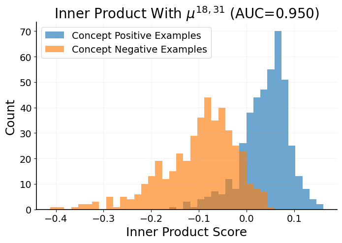
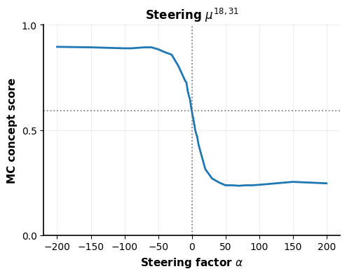

<div align="center">

<h1> Inverted Detection and Control in Steering Vectors (NeurIPS 2026) </h1>

<div>
    <a href="https://maxtorop.github.io/" target="_blank">Max Torop</a>&emsp;
    <a href="https://ariahimself.github.io/" target="_blank">Aria Masoomi</a>&emsp;
    <a href="https://mllabneu.github.io/" target="_blank">Jennifer Dy</a>
</div>
<div>
    Northeastern University
</div>


<div>
    <h4 align="center">
        <a href="https://openreview.net/pdf?id=CO7o8sDgso" target='_blank'>[Paper]</a>
    </h4>
</div>


</div>

> **Note:** this repository currently contains a minimal demonstration of the ISV phenomenon; code for all experiments in the paper will be added soon.

## 📘 Abstract

> Steering vectors (SVs) are widely used to influence the expression of concepts (e.g., truthfulness) in large language model outputs. A key assumption underpinning SVs is that they are linearly discriminative with respect to the concept: representations of texts that exhibit the concept are more aligned with the SV than those that do not, motivating shifts along the positive or negative SV direction to respectively promote or suppress the concept. In this work, we identify an inverted detection-control phenomenon in which some highly discriminative SVs that are aligned with positive representations can consistently promote the opposite behavior. We refer to such vectors as inverted-steering vectors (ISVs). We provide a geometric characterization of ISVs' effects, finding that steering along these directions systematically pushes representations in discriminative downstream heads as if the concept were absent, even prior to decoding. Motivated by this analysis, we propose an approach for distinguishing ISVs without requiring generation or associated response scoring. This enables targeted sign flips, which we use to improve a foundational detection-based steering pipeline via Inference Time Intervention (ITI). Our approach improves results in 27/30 experiments, ranging from +0.9% to +138%. We evaluate our findings on Gemma 3 12B, Qwen 2.5 14B, and Olmo 3 7B across 5 concepts.

## 🔬 The example in this repository

`isv_example.ipynb` reproduces one ISV end to end: **layer 18, head 31 of Olmo 3 7B Instruct** on the **myopic-reward** concept, the top ISV found by the multiple-choice mining procedure in the paper.
The notebook:

1. builds a mean-difference steering vector for every attention head from concept-positive and concept-negative examples (training split)
2. shows that the vector for head (18, 31) is **discriminative and aligned with the positive class** (AUC 0.95 on the test split)
3. steers that single head over a range of steering factors α and measures the multiple-choice concept score (fraction of test questions answered with the myopic option)
4. plots the result, where the concept score **decreases monotonically in α**, the opposite of normal steering.

| Discriminative and aligned with the concept | ...but steering is inverted |
|:---:|:---:|
|  |  |

Adding the vector (α > 0) pushes the concept score from its baseline of about 0.59 down to about 0.24; subtracting it (α < 0) raises the score to about 0.89.

## ⚙️ Setup

Tested on a single NVIDIA A6000 (48 GB) with CUDA 12.8.

```bash
conda create -n ISV python=3.12.12
conda activate ISV
pip install -r requirements.txt
```

Then open and run `isv_example.ipynb`.

- The model is downloaded from Hugging Face on first run (about 3–7 minutes). The notebook stores it under `./cache` (ignored by git); edit the first cell to use your default Hugging Face cache instead.
- Extracting representations takes under a minute, and the full steering sweep (43 values of α) about 7 minutes on an A6000.

## 🗂️ Repository structure

```
├── isv_example.ipynb        # the demonstration (outputs included)
├── src/
│   ├── data.py              # multiple-choice data loading, chat templating, train/val/test split
│   ├── models.py            # model loading (Unsloth) and hook locations
│   ├── steering.py          # representation extraction, mean-difference SVs, steering hooks
│   ├── discriminability.py  # per-head AUC of the steering vector
│   └── utils.py             # logit grading and plotting
├── data/
│   ├── myopic-reward.jsonl  # myopic-reward questions (see Data and licenses)
│   └── DATA_LICENSE.txt
├── assets/                  # figures used in this README
└── requirements.txt
```

## 📝 Notes

- For simplicity, the demo plots the full α range. The paper additionally prunes degraded values of α before computing ISV scores (Sec. 5).
- The paper mines ISVs on the validation split; the notebook evaluates the selected head on the held-out test split.

## 📄 Data and licenses

The myopic-reward data are the human-written questions from the Model-Written Evaluations suite (Perez et al., 2022, *Discovering Language Model Behaviors with Model-Written Evaluations*; [anthropics/evals](https://github.com/anthropics/evals)).
They are released under the Creative Commons Attribution 4.0 license, included as `data/DATA_LICENSE.txt`.

## 📚 Citation

```bibtex
@article{torop2026inverted,
  title={Inverted Detection and Control in Steering Vectors},
  author={Torop, Max and Masoomi, Aria and Dy, Jennifer},
  journal={arXiv preprint arXiv:2608.02957},
  year={2026}
}
```